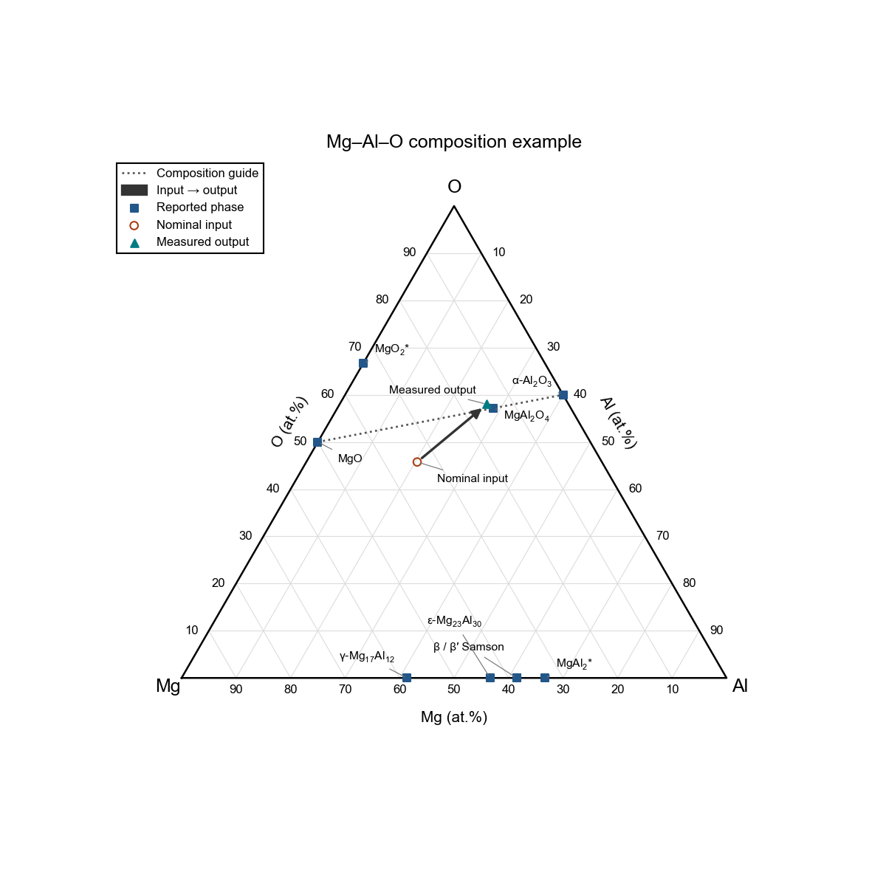

# Ternary plotting skill

Plot reported phases and sample compositions for a three-element system. The discovery workflow starts with assessed ambient-pressure phases, checks representative structures in ICSD, and uses Materials Project (MP) as a secondary source.



## Install in Codex

Install Git and Python 3.11 or newer. Run the commands for your operating system.

### macOS or Linux

```sh
mkdir -p ~/.agents/skills
git clone https://github.com/Morosan-Lab-Rice/ternary-plotting-skill.git ~/.agents/skills/ternary-plotting-skill
python3 -m venv ~/.agents/skills/ternary-plotting-skill/.venv
~/.agents/skills/ternary-plotting-skill/.venv/bin/python -m pip install matplotlib pymatgen
```

### Windows (PowerShell)

```powershell
$skillsDir = Join-Path $HOME '.agents\skills'
$skillDir = Join-Path $skillsDir 'ternary-plotting-skill'
New-Item -ItemType Directory -Force $skillsDir | Out-Null
git clone https://github.com/Morosan-Lab-Rice/ternary-plotting-skill.git $skillDir
py -3 -m venv (Join-Path $skillDir '.venv')
$skillPython = Join-Path $skillDir '.venv\Scripts\python.exe'
& $skillPython -m pip install matplotlib pymatgen
```

If you installed Python without the `py` launcher, use `python -m venv` in its place. Calling the environment’s Python directly works without activating it or changing PowerShell’s execution policy.

For a single project, clone into `.agents/skills/ternary-plotting-skill` from the project root and use that location in the commands below. Start a new Codex chat in your project and invoke `$ternary-plotting-skill`. [Codex skill installation paths](https://developers.openai.com/api/reference/cli)

## Try Mg–Al–O

In Codex, ask:

> Use $ternary-plotting-skill to render its bundled Mg–Al–O example. Use the Python environment in the installed skill folder and save the PNG in this project.

Or run the example directly from your project. On macOS or Linux:

```sh
skill_dir="$HOME/.agents/skills/ternary-plotting-skill"
"$skill_dir/.venv/bin/python" "$skill_dir/scripts/ternary.py" plot "$skill_dir/example.json" mg-al-o.png
```

On Windows, use PowerShell:

```powershell
$skillDir = Join-Path $HOME '.agents\skills\ternary-plotting-skill'
$skillPython = Join-Path $skillDir '.venv\Scripts\python.exe'
& $skillPython (Join-Path $skillDir 'scripts\ternary.py') plot (Join-Path $skillDir 'example.json') mg-al-o.png
```

The bundled example shows eight reported Mg–Al–O compositions from the literature, including the β and β′ Samson phases at a shared representative composition. Asterisks mark phases reported under specific preparation or chemical conditions. The nominal input and measured output are illustrative. It runs without ICSD access or an MP API key. To try phase discovery separately, ask Codex for an ambient-pressure Mg–Al–O phase shortlist with cited sources.

## Access ICSD through Rice

Open [ICSD through Fondren Library](https://ezproxy.rice.edu/login?url=https://icsd.fiz-karlsruhe.de/) and complete any Rice sign-in prompts. Access is ready when ICSD shows **Basic Search & Retrieve** and identifies Rice University. If the link fails, start from [Fondren’s ICSD listing](https://libguides.rice.edu/az/databases?q=ICSD).

For phase discovery, select **Experim. inorganic structures**. Check shortlisted phases using their formula or collection code. Record the collection code, release, formula, structure type or space group, pressure, and original citation. Use ICSD Web for targeted lookups and permitted exports. Scripted searches use the separately licensed [ICSD API Service](https://icsd.products.fiz-karlsruhe.de/en/products/icsd-products). See [the phase discovery guide](references.md#search-icsd-for-reported-structures).

## Set up the Materials Project API key

1. Sign in to [Materials Project](https://materialsproject.org/) or create a free account. Copy the API key from your profile dashboard.
2. Install the optional client in the same Python environment used for plotting.

   ```sh
   skill_dir="$HOME/.agents/skills/ternary-plotting-skill"
   "$skill_dir/.venv/bin/python" -m pip install mp-api
   ```
3. On macOS with zsh, enter the key at a hidden prompt for your current Terminal session.

   ```zsh
   read -rs 'MP_API_KEY?Materials Project API key: '
   printf '\n'
   export MP_API_KEY
   ```

   If you prefer automatic setup in future zsh sessions, add an `export MP_API_KEY='your-key-here'` line to your own `~/.zshrc` using a local editor. Anyone who can read that file or access your user account can read the key. Use session-only setup on shared accounts, and keep your key out of chat and Git.
4. From the same Terminal session, test the key with Mg–Al–O discovery.

   ```sh
   "$skill_dir/.venv/bin/python" "$skill_dir/scripts/ternary.py" discover Mg Al O mg-al-o-mp.json
   ```

On Windows, after setting `$skillDir` and `$skillPython` as above, install the client, enter your key at the hidden prompt, and test discovery:

```powershell
& $skillPython -m pip install mp-api
$secret = Read-Host 'Materials Project API key' -AsSecureString
$env:MP_API_KEY = [pscredential]::new('materials-project', $secret).GetNetworkCredential().Password
Remove-Variable secret
& $skillPython (Join-Path $skillDir 'scripts\ternary.py') discover Mg Al O mg-al-o-mp.json
```

To reuse the key in future Windows sessions, you can opt in to storing it as a user environment variable with `[Environment]::SetEnvironmentVariable('MP_API_KEY', $env:MP_API_KEY, 'User')`. It will be available to new processes after they pick up the updated environment. Anyone with access to your Windows account or its stored settings may be able to read it.

The resulting JSON includes the database version and counts for the three binaries and the ternary. A default plot uses compositions with an experimental structure match. Add `--include-theoretical` to the plot command to show theoretical entries at 20% opacity. [Materials Project API setup](https://docs.materialsproject.org/downloading-data/using-the-api/getting-started)
